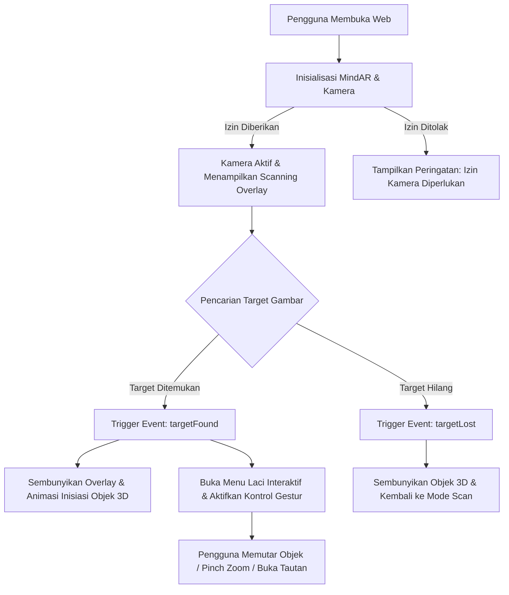

# 📖 Dokumentasi Teknis: AR BM3 DEKAVE (WebAR Showcase)

Aplikasi Augmented Reality berbasis Web (WebAR) interaktif untuk memamerkan karya visual siswa Desain Komunikasi Visual (DKV) SMK Bina Mandiri Multimedia. Aplikasi ini memungkinkan pengguna memindai kartu nama/karya fisik menggunakan kamera browser ponsel atau komputer tanpa perlu memasang aplikasi tambahan dari Play Store atau App Store.

---

## 📑 Daftar Isi
1. [Tentang Proyek](#-tentang-proyek)
2. [Teknologi & Dependensi](#-teknologi--dependensi)
3. [Struktur Direktori](#-struktur-direktori)
4. [Daftar Target Marker & Aset](#-daftar-target-marker--aset)
5. [Fitur-Fitur Utama](#-fitur-fitur-utama)
6. [Penyiapan Studio Editor (Supabase)](#-penyiapan-studio-editor-supabase)
7. [Arsitektur & Alur Kerja Sistem](#-arsitektur--alur-kerja-sistem)
8. [Panduan Menjalankan Aplikasi](#-panduan-menjalankan-aplikasi)
   - [A. Menjalankan di Komputer Lokal](#a-menjalankan-di-komputer-lokal)
   - [B. Menjalankan di Smartphone (Wi-Fi Lokal)](#b-menjalankan-di-smartphone-wi-fi-lokal)
   - [C. Deployment ke Cloud / Hosting](#c-deployment-ke-cloud--hosting)
8. [Panduan Mengubah & Menambah Target Marker](#-panduan-mengubah--menambah-target-marker)
9. [Troubleshooting & Solusi Masalah](#-troubleshooting--solusi-masalah)

---

## 🌟 Tentang Proyek

* **Nama Proyek:** AR BM3 DEKAVE (*Visual Feeder AR Business Card*)
* **Repository:** `mymalikismatulloh-sys/AR-BM3DEKAVE`
* **Institusi:** SMK Bina Mandiri Multimedia (DKV)
* **Kategori:** Web-based Augmented Reality (Image Tracking & Interactive 3D Showcase)

Aplikasi ini menggunakan teknologi **Image Target Tracking** di mana kamera mendeteksi gambar marker khusus (karya cetak/kartu), kemudian memproyeksikan visual 3D yang melayang di atas marker tersebut secara presisi secara real-time.

---

## 🛠️ Teknologi & Dependensi

Proyek ini dibuat menggunakan teknologi web standar sehingga sangat ringan dan kompatibel di berbagai perangkat seluler:

| Komponen | Teknologi | Keterangan |
| :--- | :--- | :--- |
| **AR Engine** | [MindAR.js v1.2.0](https://hiukim.github.io/mind-ar-js-doc/) | Engine WebAR open-source untuk pelacakan gambar menggunakan WebGL & WebAssembly |
| **3D Rendering** | [A-Frame v1.3.0](https://aframe.io/) & [Three.js](https://threejs.org/) | Framework grafis 3D declaratif berbasis HTML WebGL |
| **Bahasa Utama** | HTML5, CSS3, JavaScript ES6+ | Struktur, UI futuristik (*cyberpunk glassmorphism*), dan kontrol interaksi |
| **Model Tracking** | `targets.mind` | Binary feature data yang diekstrak dari gambar target untuk pendeteksian kamera |

---

## 📂 Struktur Direktori

```text
f:\Project AR NEW/
│
├── Karya/                      # Direktori koleksi aset visual karya siswa DKV
│   ├── Artboard 1@300x-100.jpg # Aset visual untuk Target Index 0
│   ├── Bilqis X DKV 01.png     # Aset visual untuk Target Index 1
│   ├── Rizka Afrilia Azzahra XI DKV 2 .png # Aset visual untuk Target Index 2
│   ├── maaf salah masukin.jpg  # Aset visual untuk Target Index 3
│   └── ... (aset ilustrasi dan desain pendukung lainnya)
│
├── Video/                      # Direktori aset video proyeksi AR
│   └── pecah lagu pecah lai.mp4# Video multimedia untuk ekstensi AR video
│
├── index.html                  # File inti aplikasi WebAR (UI, Scene AR, & Skrip Interaktif)
├── targets.mind                # File kompilasi target marker yang dibaca oleh MindAR
├── studio.html                 # Editor karya tanpa login (mode lokal)
├── studio.js                   # Operasi Studio Editor lokal
├── studio-storage.js           # Penyimpanan browser menggunakan IndexedDB
├── supabase-config.js          # Konfigurasi opsional Supabase untuk integrasi berikutnya
├── supabase/
│   └── schema.sql              # Tabel, Storage bucket, dan kebijakan RLS
├── package.json                # Konfigurasi proyek dan referensi repositori Git
├── ind.txt                     # File referensi eksperimen untuk pemutaran video AR
└── DOKUMENTASI.md              # Dokumentasi lengkap sistem aplikasi (file ini)
```

---

## 🎯 Daftar Target Marker & Aset

File [targets.mind](targets.mind) menyimpan fitur pelacakan untuk target gambar dengan pemetaan berikut di [index.html](index.html):

| Target Index | ID Entitas AR | Sumber Aset Gambar | Rasio Ukuran Bidang 3D (W × H) |
| :---: | :---: | :---: | :---: |
| **0** | `#image-target-0` | `Karya/Artboard 1@300x-100.jpg` | `1.0 × 1.78` |
| **1** | `#image-target-1` | `Karya/Bilqis X DKV 01.png` | `1.0 × 1.414` |
| **2** | `#image-target-2` | `Karya/Rizka Afrilia Azzahra XI DKV 2 .png` | `1.0 × 1.414` |
| **3** | `#image-target-3` | `Karya/maaf salah masukin.jpg` | `1.0 × 0.702` |

> Setiap target dirender dengan **2 sisi (Double-Sided Plane)**: satu sisi menghadap ke depan dan satu sisi diputar 180° menghadap ke belakang sehingga karya tetap terlihat jelas saat dilihat dari sudut berlawanan.

---

## 🚀 Fitur-Fitur Utama

### 1. 📷 Pendeteksian Kamera & Indikator Status Otomatis
- Memeriksa konteks aman (`HTTPS` atau `localhost`) dan dukungan kamera sebelum pemindaian dimulai.
- Kamera baru diminta setelah pengguna menekan **Mulai pemindaian**, sehingga izin kamera tidak muncul otomatis saat halaman dibuka.
- MindAR mengelola permintaan kamera dan izin satu kali; aplikasi tidak membuka aliran kamera kedua hanya untuk memeriksa status.
- Status kamera membedakan proses mulai, kamera aktif, target ditemukan/hilang, dan beberapa penyebab kegagalan umum.
- Jika kamera gagal dimulai, instruksi sesuai galat ditampilkan bersama tombol **Coba kamera lagi**.

### 2. 🔲 Panduan Pemindaian Cerdas (*Dynamic Scanning Indicator*)
- Kartu panduan mengarahkan pengguna mencari marker, menjaga pencahayaan, dan mengembalikan pengguna ke mode pemindaian saat marker hilang.
- Elemen SVG memberikan retikel lembut di tengah layar saat mencari target. Saat target terdeteksi (`targetFound`), garis hijau mengikuti proyeksi keempat sudut marker selama sekitar 1,2 detik lalu menghilang; retikel pencarian kembali jika marker hilang. Rasio marker berasal dari ukuran gambar target sehingga bingkai menyesuaikan bentuk, perspektif, jarak, dan pergerakan kamera.
- Panduan menghormati pengaturan **reduced motion** pada perangkat.

### 3. ✨ Animasi Masuk 3D & Tracking Marker
- Objek 3D tetap berada di dalam hierarchy target MindAR agar posisinya selalu tertambat dengan benar pada marker.
- Animasi masuk menggunakan kurva *ease-out* (`animateImageIn`) dengan efek *scaling* dinamis.
- Untuk mengurangi getaran saat memindai, jaga jarak dan pencahayaan tetap stabil serta tahan HP dengan kedua tangan atau sangga pada permukaan.

### 4. 👆 Kontrol Interaksi Sentuhan Lengkap (*Multi-Touch Gestures*)
- **Rotasi 360° Bebas (1 Jari / Drag Mouse):** Saat marker terdeteksi, usap area kamera ke kiri/kanan untuk memutar sumbu Y atau ke atas/bawah untuk memutar sumbu X. Drag ditangkap oleh kanvas AR agar tetap terbaca saat jari bergerak; rotasi dapat berlanjut melewati satu putaran penuh.
- **Pinch to Zoom (2 Jari):** Mencubit layar untuk memperbesar atau memperkecil skala karya 3D secara dinamis dengan batas aman (*clamped* antara `0.55x` hingga `1.6x`).
- **Drag Stabil:** Satu jari pada kanvas kamera ditangkap selama gesture sehingga rotasi horizontal dan vertikal tetap terbaca meski jari sedikit keluar dari bidang karya.
- **Kontrol Rotasi di Layar:** Tombol arah memutar karya per 15° pada sumbu X/Y dan tersedia selama marker terdeteksi. Menu **Atur ulang** mengembalikan rotasi ke awal.
- **Rekomendasi rotasi paling stabil:** gunakan tombol arah untuk penyetelan sudut kecil, lalu drag satu jari untuk melihat karya dari sudut bebas; tahan HP dengan kedua tangan atau sangga di permukaan agar tracking marker tidak ikut berguncang.

### 5. 🎛️ Menu Laci Melingkar Futuristik (*Futuristic Radial Menu Drawer*)
- Tombol **MENU** neon bergaya sci-fi di tepi kiri layar yang dapat ditarik (*expand/collapse*).
- Dilengkapi **Roda Putar Kemudi (*Interactive Rotary Dial*)**: pengguna dapat memutar roda kemudi menu secara melingkar menggunakan sentuhan jari.
- Tombol-tombol aksi di dalam laci menu:
  - 🔄 **Atur ulang:** Mengembalikan sudut rotasi ke posisi awal (0,0,0) dan skala kembali normal (1.0x).
  - 👁️ **Sembunyikan / Tampilkan gambar:** Opsi untuk menyembunyikan atau memunculkan kembali visual 3D di atas marker.
  - 🔗 **Tautan:** Menampilkan panel pintasan tautan resmi:
    - **Website Sekolah:** [smkbinamandirimultimedia.sch.id](https://smkbinamandirimultimedia.sch.id/)
    - **Instagram:** [@smkbm_3](https://www.instagram.com/smkbm_3/)

---

## 🧰 Studio Editor tanpa login (mode lokal)

Editor tersedia di [studio.html](studio.html) dan saat ini **tidak memerlukan login**. Editor dapat menambah, mengubah, menghapus, dan menonaktifkan karya; menerima gambar marker serta konten gambar/video; mengatur ukuran dan posisi bidang AR; serta menyimpan file `.mind`. Data dan file disimpan di IndexedDB browser, lalu dapat dibaca oleh halaman AR pada browser dan origin yang sama.

**Mode ini bersifat lokal, bukan publik:** data hanya ada di profil browser/perangkat yang mengedit. Tidak disinkronkan ke pengunjung lain atau browser berbeda, dan menghapus data situs/browser dapat menghapus konten Studio. Ini menghindari pembukaan akses tulis publik saat autentikasi backend belum dikonfigurasi.

- Jalankan aplikasi melalui server lokal (`python -m http.server 8080`) dan buka `/studio.html`.
- Nomor **Index marker** harus sama dengan urutan gambar di file `targets.mind`. Untuk marker baru atau susunan berubah, kompilasi ulang semua marker melalui [MindAR Image Compiler](https://hiukim.github.io/mind-ar-js-doc/tools/compile), lalu unggah `.mind` pada editor.
- Gambar marker adalah gambar fisik yang dipindai; konten AR mendukung gambar atau video. Ukuran bidang dan posisi X/Y/Z menggunakan satuan A-Frame.
- File marker, konten, dan tracking dibatasi hingga 50 MB per file.

Sinkronisasi lintas pengguna dapat diaktifkan kembali setelah backend dan autentikasi admin disiapkan. [supabase/schema.sql](supabase/schema.sql) tetap tersedia sebagai fondasi konfigurasi server; jangan membuat kebijakan tulis publik atau menaruh `service_role` key dalam frontend.

---

## 🏗️ Arsitektur & Alur Kerja Sistem



---

## 💻 Panduan Menjalankan Aplikasi

> **PENTING (Syarat Keamanan Browser):**
> Fitur kamera WebAR **hanya dapat berjalan** pada:
> 1. Lingkungan lokal: `http://localhost` atau `http://127.0.0.1`
> 2. Jaringan eksternal yang menggunakan protokol terenkripsi **HTTPS** (kamera diblokir browser jika menggunakan HTTP biasa di luar localhost).

### A. Menjalankan di Komputer Lokal

Buka terminal di folder proyek (`f:\Project AR NEW`), jalankan salah satu perintah berikut:

#### Opsi 1: Menggunakan Python (Sudah Terpasang)
```powershell
python -m http.server 8080
```
Buka browser di: [http://localhost:8080](http://localhost:8080)

#### Opsi 2: Menggunakan Node.js / npx
```powershell
npx -y serve -p 8080 .
```

---

### B. Menjalankan di Smartphone (Wi-Fi Lokal)

Untuk menguji langsung menggunakan kamera ponsel tanpa deployment internet:
1. Pastikan laptop dan HP terhubung ke **jaringan Wi-Fi yang sama**.
2. Cari IP laptop Anda (misal `192.168.1.99` atau `172.16.3.216`).
3. Jalankan server lokal dengan opsi HTTPS (atau gunakan bantuan **ngrok / Cloudflare Tunnel** agar mendapat URL HTTPS gratis):
   ```powershell
   npx ngrok http 8080
   ```
4. Buka URL HTTPS dari ngrok di browser Chrome/Safari pada HP Anda, izinkan akses kamera, lalu arahkan ke gambar target!

---

### C. Deployment ke Cloud / Hosting

Aplikasi ini bersifat statis (*Client-Side Static Web*), sehingga sangat mudah di-deploy secara gratis ke layanan yang mendukung HTTPS otomatis:

1. **GitHub Pages:**
   - Push proyek ke repository GitHub: `https://github.com/mymalikismatulloh-sys/AR-BM3DEKAVE`
   - Buka menu **Settings** > **Pages** di GitHub.
   - Pilih branch `main` dan folder `/ (root)`, lalu klik **Save**.
   - URL HTTPS instan Anda akan aktif (contoh: `https://mymalikismatulloh-sys.github.io/AR-BM3DEKAVE/`).

2. **Vercel / Netlify:**
   - Sambungkan repository GitHub ke Vercel atau Netlify.
   - Biarkan konfigurasi build kosong (karena ini adalah file HTML statis).
   - Klik **Deploy**.

---

## 🎨 Panduan Mengubah & Menambah Target Marker

Jika Anda ingin mengganti atau menambah karya seni baru sebagai target pemindaian:

1. Siapkan file gambar target (disarankan format JPG/PNG dengan kontras warna yang baik dan kaya fitur visual/tekstur).
2. Kunjungi tool compiler resmi MindAR:
   👉 **[MindAR Image Compiler Online](https://hiukim.github.io/mind-ar-js-doc/tools/compile)**
3. Unggah seluruh gambar target yang ingin dimasukkan secara berurutan.
4. Klik **Compile** dan unduh file hasilnya, lalu beri nama `targets.mind`.
5. Timpa file `targets.mind` lama di folder proyek dengan file yang baru diunduh.
6. Perbarui konfigurasi di [index.html](index.html):
   - Tambahkan elemen `` di dalam `<a-assets>`.
   - Tambahkan `<a-entity mindar-image-target="targetIndex: X" ...>` di dalam `<a-scene>` dengan menyesuaikan rasio tinggi dan lebar karya.

---

## ❓ Troubleshooting & Solusi Masalah

| Masalah | Kemungkinan Penyebab | Cara Mengatasi |
| :--- | :--- | :--- |
| **Kamera tidak muncul / layar hitam** | Protokol bukan HTTPS atau izin kamera diblokir browser. | Pastikan mengakses via `http://localhost` (lokal) atau via **HTTPS** jika diakses dari perangkat lain / internet. Periksa pengaturan izin situs di browser dan pilih *Allow Camera*. |
| **Pesan "Error loading targets.mind"** | File dibuka langsung dengan cara *double click* (`file:///...`). | Browser memblokir pembacaan file lokal dengan fetch karena aturan CORS. Selalu jalankan melalui HTTP Server (`python -m http.server` atau `npx serve`). |
| **Marker sulit terdeteksi oleh kamera** | Gambar target terlalu polos atau pencahayaan ruangan kurang. | Gunakan gambar dengan detail visual tinggi (banyak sudut/teks/kontras). Hindari gambar yang hanya memiliki warna gradasi polos atau permukaan memantulkan cahaya. |
| **Gambar 3D terlihat gepeng atau terdistorsi** | Rasio bidang `a-plane` tidak cocok dengan rasio asli gambar. | Sesuaikan atribut `width` dan `height` pada elemen `a-plane` di `index.html` sesuai rasio gambar asli (contoh: `width="1" height="1.414"` untuk format standar A4). |

---

## 👥 Pengembang & Hak Cipta
* **Pengembang:** Tim Proyek DKV SMK Bina Mandiri Multimedia
* **Lisensi:** ISC License
* **Karya Seni:** © Siswa-siswi Desain Komunikasi Visual (DKV) SMK BM3
